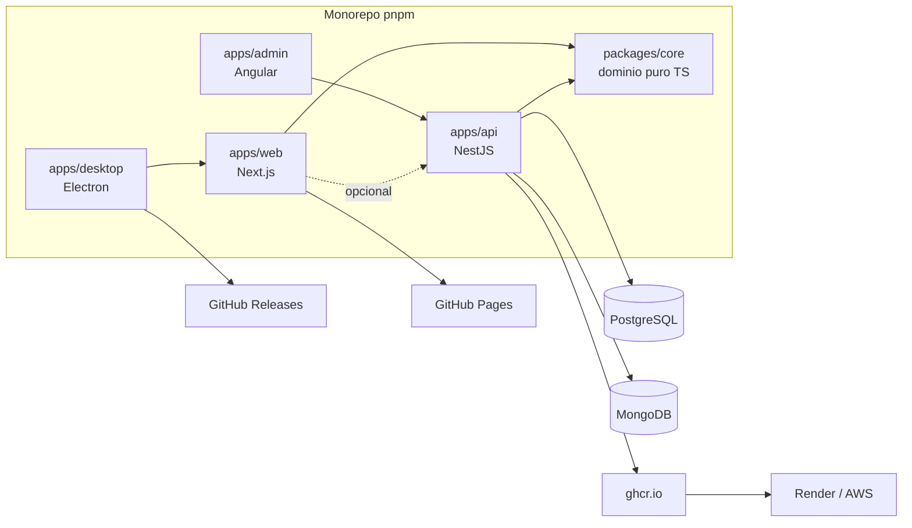

# Tag Generator: de HTML a aplicación

Este tutorial sirve para practicar tu plan de estudio migrando `tag_generator.html` a una aplicación con:

- frontend en Next.js,
- API en NestJS,
- PostgreSQL y MongoDB,
- app de escritorio con Electron,
- CI/CD con versionado,
- despliegue en GitHub Pages.

No hay código resuelto. Cada fase te dice **qué** conseguir y **dónde** leer. El **cómo** lo sacas tú de la documentación.

## Cómo usarlo

- Haz las fases en orden. Cada una deja algo desplegable o comprobable, y las siguientes se apoyan en ella.
- Cada fase tiene estas partes:
  - **Objetivo:** qué tiene que existir al acabar.
  - **Practicas:** el bloque del plan de estudio que trabaja.
  - **Tareas:** lo mínimo que hay que hacer, sin pasos.
  - **Decide:** las decisiones que tomas tú y documentas en un ADR (`docs/adr/NNNN-titulo.md`).
  - **Docs:** la documentación oficial que necesitas.
  - **Hecho cuando:** criterios comprobables. No pases de fase sin cumplirlos.
- Trabaja con TDD siempre que haya lógica: primero el test que falla, luego el código y después el refactor.
- Si un enlace ha cambiado, búscalo por su título en la web oficial.

## Arquitectura objetivo

La idea central es una **arquitectura hexagonal**:

- `packages/core` contiene el dominio y no sabe nada de React, Electron, el navegador ni la base de datos: grupos, etiquetas, labels, estilos, layout y generación del SVG.
- Todo lo externo entra por **puertos**: guardar, cargar, obtener fuentes, etc.
- Cada app aporta sus **adaptadores** (localStorage, diálogos de Electron, API REST…).

La app debe funcionar **sin backend**, en Pages y en Electron. La API añade cuentas, tableros en la nube, compartir e IA.

### Decisiones que tendrás que documentar (ADRs)

| ADR  | Decisión                                                                          |
| ---- | --------------------------------------------------------------------------------- |
| 0001 | Registrar decisiones con ADRs y su plantilla                                      |
| 0002 | Monorepo: pnpm workspaces solo, o con Turborepo o Nx                              |
| 0003 | Hooks de git: nativos versionados en `.githooks/`, husky o lefthook _(adicional)_ |
| 0004 | Límites del dominio y puertos de `packages/core`                                  |
| 0005 | Gestor de releases: release-please, semantic-release o changesets                 |
| 0006 | ORM o query builder para PostgreSQL: Drizzle, Prisma o TypeORM                    |
| 0007 | Autenticación de la API: JWT propio u OAuth con GitHub                            |
| 0008 | Qué datos van a MongoDB y cuáles a PostgreSQL                                     |
| 0009 | SSG en Pages frente a SSR en Vercel                                               |
| 0010 | Despliegue: PaaS gratuito frente a AWS                                            |

> El ADR 0003 no estaba en el plan original: surgió en la fase 0 al decidir cómo instalar el hook de commitlint. Los ADR se numeran por orden de creación, así que los siguientes se han desplazado un número.

---

## Fase 0 · Preparación

**Objetivo:** un repositorio vacío pero con reglas.
**Practicas:** bloques 5 y 7.

**Tareas**

- Crea el repo `tag-generator` en GitHub y clónalo aquí.
- Copia `tag_generator.html` a `legacy/`. Es tu especificación funcional.
- Configura un monorepo con pnpm workspaces (`apps/*` y `packages/*`).
- Prepara TypeScript base (`tsconfig.base.json` en modo estricto), ESLint y Prettier compartidos.
- Adopta Conventional Commits desde el primer commit y valídalos con un hook (commitlint con husky o lefthook).
- Protege `main`: nada entra sin PR y sin CI en verde. Esa regla se activa en la fase 3.
- Escribe los ADR 0001 y 0002. El 0003 (hooks de git) surgió aquí de forma adicional.

**Docs**

- [pnpm workspaces](https://pnpm.io/workspaces)
- [TSConfig: strict](https://www.typescriptlang.org/tsconfig/#strict)
- [Conventional Commits](https://www.conventionalcommits.org/es/v1.0.0/)
- [commitlint](https://commitlint.js.org/)
- [ADR](https://adr.github.io/)
- [Reglas de protección de ramas](https://docs.github.com/es/repositories/configuring-branches-and-merges-in-your-repository/managing-protected-branches/about-protected-branches)

**Hecho cuando**

- [x] `pnpm -r lint` funciona, aunque no haya nada que analizar. El output esperado, ya que no hay paquetes, es:
<code>

No projects matched the filters in "C:\Users\gonza\repos\tag-generator"
exit: 0
</code>

- [x] Un commit con mensaje no convencional se rechaza.
- [x] Hay `docs/adr/0001-*.md` y `0002-*.md`.

---

## Fase 1 · Dominio con TDD (`packages/core`)

**Objetivo:** toda la lógica del HTML portada a TypeScript puro, con tests.
**Practicas:** bloques 1 y 5.

**Tareas**

- Modela los tipos: `Tag`, `Group`, `LabelStyle`, `GroupLabel`, `Palette` y `State`. Usa uniones discriminadas y tipos literales donde encajen, como en la alineación.
- Escribe cada función con TDD, empezando por los casos del HTML:
  - `nearestWeight`.
  - `normalizeStyle` y `normalizeGroupLabel`, incluida la migración del formato antiguo.
  - `normalizeState`.
  - `computeBorder`.
  - El layout: columnas, salto de línea y altura de fila.
  - La generación del SVG.
- Define los **puertos** como interfaces:
  - el repositorio del estado (cargar y guardar),
  - el proveedor de fuentes (dada una familia, un peso y un estilo, devuelve algo capaz de medir el texto y dar su trazado),
  - el exportador de ficheros.
- El generador de SVG no descarga fuentes: las recibe por el puerto. Así lo pruebas con una fuente de test, sin red.
- **Test de referencia:** exporta un SVG con el HTML de `legacy/`, guárdalo como fixture y comprueba que tu core genera uno equivalente con el mismo JSON.
- Mide la cobertura. No persigas el 100 %: cubre los casos con lógica.

**Decide:** ADR 0004, sobre qué es dominio y qué es adaptador. Un caso límite: ¿la lista de fuentes de Fontsource es dominio o configuración?

**Docs**

- [Vitest](https://vitest.dev/guide/)
- [Mocking en Vitest](https://vitest.dev/guide/mocking)
- [Cobertura](https://vitest.dev/guide/coverage)
- [Narrowing en TypeScript](https://www.typescriptlang.org/docs/handbook/2/narrowing.html)
- [Hexagonal Architecture (Cockburn)](https://alistair.cockburn.us/hexagonal-architecture/)
- [opentype.js](https://github.com/opentypejs/opentype.js)

**Hecho cuando**

- [ ] `pnpm --filter core test` pasa sin red.
- [ ] El test de referencia compara contra el SVG del HTML original.
- [ ] El core no importa nada de `window`, `document` ni `fetch`.

---

## Fase 2 · Frontend con Next.js y TypeScript (`apps/web`)

**Objetivo:** el editor completo en Next.js, con la misma funcionalidad que el HTML.
**Practicas:** bloques 1 y 3.

**Tareas**

- Crea la app con el App Router. Como irá a Pages, configúrala para export estático (`output: 'export'`, con `basePath` para `/<repo>`).
- Divide la UI en componentes:
  - la barra con la paleta, el estilo global y la exportación,
  - la tarjeta de grupo,
  - el editor de estilo, reutilizable para el global y el de cada grupo,
  - la etiqueta,
  - el modo captura.
- Estado local: elige entre `useReducer` + Context y una librería. El reducer se testea muy bien con TDD.
- Implementa el adaptador de localStorage del puerto de la fase 1. El de la File System Access API es opcional.
- Prueba con React Testing Library el **comportamiento**, no la implementación:
  - "escribo, pulso Enter y aparece la etiqueta con el color del grupo",
  - "marco Personalizar y aparece el editor".
- Rendimiento: carga opentype.js y las fuentes **solo al exportar**, con import dinámico. Mide con Lighthouse antes y después y apunta los números en el README.

**Docs**

- [Next.js: Static Exports](https://nextjs.org/docs/app/guides/static-exports)
- [Lazy Loading](https://nextjs.org/docs/app/guides/lazy-loading)
- [Testing Library: React](https://testing-library.com/docs/react-testing-library/intro/)
- [Consultas por rol](https://testing-library.com/docs/queries/byrole)
- [user-event](https://testing-library.com/docs/user-event/intro)
- [Next.js con Vitest](https://nextjs.org/docs/app/guides/testing/vitest)
- [Lighthouse](https://developer.chrome.com/docs/lighthouse/overview)

**Hecho cuando**

- [ ] `pnpm --filter web build` genera `out/` y funciona servido como estático.
- [ ] Un JSON guardado con el HTML original se carga sin errores.
- [ ] El bundle inicial no incluye opentype.js. Compruébalo en el informe del build o en DevTools.

---

## Fase 3 · CI y despliegue en GitHub Pages

**Objetivo:** cada PR se valida y cada merge a `main` publica la web.
**Practicas:** bloques 1 y 7.

**Tareas**

- Crea un workflow de CI en PR y en push a `main`: instala con caché de pnpm y ejecuta lint, typecheck, test y build.
- Añade **Playwright** con 2 o 3 flujos E2E contra el export estático servido en local, como crear un grupo, añadir etiquetas y exportar el SVG. Comprueba la descarga.
- Crea un workflow de Pages que suba `apps/web/out` como artefacto y lo despliegue. En la configuración del repo, Pages debe tomar la fuente de "GitHub Actions".
- Activa la protección de `main` con el check de CI obligatorio.

**Docs**

- [GitHub Actions: sintaxis de workflows](https://docs.github.com/es/actions/reference/workflows-and-actions/workflow-syntax)
- [Caché de dependencias (setup-node)](https://github.com/actions/setup-node#caching-global-packages-data)
- [Pages con workflows propios](https://docs.github.com/es/pages/getting-started-with-github-pages/using-custom-workflows-with-github-pages)
- [actions/deploy-pages](https://github.com/actions/deploy-pages)
- [Playwright](https://playwright.dev/docs/intro)
- [Playwright: webServer](https://playwright.dev/docs/test-webserver)
- [Playwright: descargas](https://playwright.dev/docs/downloads)
- [Playwright en CI](https://playwright.dev/docs/ci-intro)

**Hecho cuando**

- [ ] Un PR con un test roto no se puede mergear.
- [ ] `https://<usuario>.github.io/tag-generator/` sirve la app, con los assets bien resueltos.
- [ ] Los E2E corren en CI y guardan el informe o las trazas como artefacto si fallan.

---

## Fase 4 · Versionado y releases

**Objetivo:** versiones SemVer automáticas a partir de los commits, con CHANGELOG y GitHub Release.
**Practicas:** bloque 7.

**Tareas**

- Configura el gestor de releases: en cada merge mantiene abierto un PR de release, y al mergearlo crea el tag `vX.Y.Z` y la Release.
- Decide si versionas el monorepo con una sola versión o cada paquete por separado. Para empezar, basta con una sola.
- Haz que los demás workflows se disparen con la release: los ejecutables, la imagen Docker y el despliegue del backend.
- Muestra la versión en la app, en el pie o en el "Acerca de", leída en el build.

**Decide:** ADR 0005.

**Docs**

- [SemVer](https://semver.org/lang/es/)
- [release-please-action](https://github.com/googleapis/release-please-action)
- [Disparar workflows con el evento release](https://docs.github.com/es/actions/reference/workflows-and-actions/events-that-trigger-workflows#release)
- [GITHUB_TOKEN y workflows encadenados](https://docs.github.com/es/actions/concepts/security/github_token)

**Hecho cuando**

- [ ] Un `feat:` mergeado genera un PR de release con un salto _minor_, y un `fix:` con un salto _patch_.
- [ ] Al mergear el PR de release aparecen el tag, la Release y el CHANGELOG.
- [ ] La versión visible en la app coincide con el tag.

> Trampa habitual: los eventos creados con el `GITHUB_TOKEN` por defecto no disparan otros workflows. Lee el enlace de arriba antes de pelearte con ello.

---

## Fase 5 · Ejecutable de escritorio con Electron (`apps/desktop`)

**Objetivo:** que cualquiera se descargue la app desde Releases y la abra sin instalar nada más.
**Practicas:** bloques 5 y 7.

**Tareas**

- Crea un proceso principal de Electron que cargue el export estático de `apps/web`, empaquetado dentro de la app y no desde Pages, para que funcione sin conexión.
- Guarda y abre ficheros con los diálogos nativos. Es **otro adaptador** del puerto de ficheros: si el dominio de la fase 1 está bien separado, no tocas el core.
- Seguridad: `contextIsolation` activado, sin `nodeIntegration` en el renderer, y una API mínima expuesta con `contextBridge` desde un preload.
- Las fuentes vienen de Fontsource por red. Decide si las empaquetas para trabajar sin conexión o si avisas cuando no hay red.
- Empaqueta con electron-builder en un workflow con **matriz** Windows, macOS y Linux, disparado por la release de la fase 4. Sube los artefactos a esa misma Release.
- Opcional: actualización automática con `electron-updater` desde GitHub Releases.

**Docs**

- [Electron: tutorial](https://www.electronjs.org/docs/latest/tutorial/tutorial-prerequisites)
- [Electron: seguridad](https://www.electronjs.org/docs/latest/tutorial/security)
- [Context Isolation](https://www.electronjs.org/docs/latest/tutorial/context-isolation)
- [dialog](https://www.electronjs.org/docs/latest/api/dialog)
- [electron-builder](https://www.electron.build/)
- [Publicar en GitHub](https://www.electron.build/publish)
- [Matrices en Actions](https://docs.github.com/es/actions/how-tos/write-workflows/choose-what-workflows-do/run-job-variations)

**Hecho cuando**

- [ ] La Release `vX.Y.Z` trae un `.exe` o instalador de Windows, un `.dmg` y un AppImage.
- [ ] Descargado en un equipo limpio, abre, guarda un JSON y exporta un SVG.
- [ ] En el renderer, `window.require` no existe.

> Sin certificados de firma, Windows y macOS avisarán al abrirla. Explícalo en el README; firmar queda fuera de alcance.

---

## Fase 6 · API con NestJS y PostgreSQL (`apps/api`)

**Objetivo:** una API REST para guardar tableros en la nube.
**Practicas:** bloques 4 y 6.

**Tareas**

- **Calentamiento:** antes de Nest, monta en **Express** puro un `GET /health` y un `POST /echo` con validación hecha a mano. Así entiendes lo que Nest te abstrae. Luego tíralo.
- Diseña el **contrato** antes de programar, con OpenAPI o una tabla en `docs/api.md`: recursos `boards` y `users`, códigos de estado, formato de error y paginación por cursor u offset (decide cuál y por qué).
- En Nest, organiza por módulos con controller, service y repositorio. Aplica hexagonal también aquí: los casos de uso no conocen el ORM.
- Validación con DTOs y `ValidationPipe`, y un filtro de excepciones global con un formato de error único.
- Autenticación con registro y login, y rutas protegidas con guards.
- Documentación generada en `/docs` con Swagger.
- **PostgreSQL:** esquema con migraciones e índices pensados para tus consultas. Lanza `EXPLAIN ANALYZE` sobre el listado paginado con unos 10 000 tableros de prueba y optimízalo.
- **Tests:**
  - unitarios de los servicios, con los puertos mockeados,
  - de integración HTTP con supertest contra un Postgres real levantado con Testcontainers.
- Reutiliza `packages/core` para validar y normalizar el estado que llega del cliente.

**Decide:** ADR 0006 (ORM) y ADR 0007 (autenticación).

**Docs**

- [Express: primeros pasos](https://expressjs.com/es/starter/hello-world/)
- [NestJS](https://docs.nestjs.com/)
- [Validación](https://docs.nestjs.com/techniques/validation)
- [Exception filters](https://docs.nestjs.com/exception-filters)
- [Autenticación](https://docs.nestjs.com/security/authentication)
- [OpenAPI](https://docs.nestjs.com/openapi/introduction)
- [Testing](https://docs.nestjs.com/fundamentals/testing)
- [Drizzle](https://orm.drizzle.team/docs/overview)
- [Prisma](https://www.prisma.io/docs)
- [PostgreSQL: EXPLAIN](https://www.postgresql.org/docs/current/using-explain.html)
- [Índices](https://www.postgresql.org/docs/current/indexes.html)
- [Testcontainers para Node](https://node.testcontainers.org/)

**Hecho cuando**

- [ ] `/docs` muestra el contrato y coincide con lo implementado.
- [ ] Los tests de integración levantan y destruyen su propio Postgres.
- [ ] Tienes en `docs/` el antes y el después de un `EXPLAIN ANALYZE`.

---

## Fase 7 · Docker

**Objetivo:** la API y sus dependencias se levantan con un solo comando, y la imagen se publica en cada release.
**Practicas:** bloque 7.

**Tareas**

- Escribe un Dockerfile **multi-stage** para la API, con imagen final pequeña, usuario no root y `HEALTHCHECK`.
- Crea un `compose.yaml` con la API, PostgreSQL y MongoDB (lo usarás en la fase 10), con volúmenes y variables desde `.env`.
- En el CI de la API, corre los tests de integración usando **service containers** de Actions, o Testcontainers si funciona en el runner.
- En cada release, construye y publica la imagen en `ghcr.io` con la etiqueta de la versión.

**Docs**

- [Builds multi-stage](https://docs.docker.com/build/building/multi-stage/)
- [Buenas prácticas de Dockerfile](https://docs.docker.com/build/building/best-practices/)
- [Docker Compose](https://docs.docker.com/compose/)
- [Service containers](https://docs.github.com/es/actions/tutorials/use-containerized-services/use-docker-service-containers)
- [Container registry (ghcr.io)](https://docs.github.com/es/packages/working-with-a-github-packages-registry/working-with-the-container-registry)
- [docker/build-push-action](https://github.com/docker/build-push-action)

**Hecho cuando**

- [ ] `docker compose up` deja la API sana en `localhost` con su base de datos.
- [ ] La imagen final pesa menos de unos 200 MB.
- [ ] Cada release publica `ghcr.io/<usuario>/tag-generator-api:X.Y.Z`.

---

## Fase 8 · Conectar la web con la API

**Objetivo:** con sesión iniciada, los tableros se guardan en la nube. Sin sesión, todo sigue siendo local.
**Practicas:** bloque 3.

**Tareas**

- Escribe un adaptador **remoto** del puerto de almacenamiento. La app elige entre el local y el remoto según haya sesión.
- Usa TanStack Query para listar, cargar y guardar tableros, con mutaciones, invalidación y estado de carga y error. Opcional: actualización optimista al guardar.
- Añade el login en la web y decide dónde vive el token (consulta el ADR 0007).
- Los tipos del contrato no se duplican: genéralos desde el OpenAPI o compártelos desde un paquete.
- La URL de la API se configura por variable de entorno en el build. En Pages y en Electron sin API, la parte remota no aparece.

**Docs**

- [TanStack Query](https://tanstack.com/query/latest/docs/framework/react/overview)
- [Mutations](https://tanstack.com/query/latest/docs/framework/react/guides/mutations)
- [Optimistic updates](https://tanstack.com/query/latest/docs/framework/react/guides/optimistic-updates)
- [Variables de entorno en Next.js](https://nextjs.org/docs/app/guides/environment-variables)
- [openapi-typescript](https://openapi-ts.dev/)

**Hecho cuando**

- [ ] Con sesión, recargar en otro navegador muestra el mismo tablero.
- [ ] Sin API, la app funciona igual que en la fase 2.
- [ ] Hay un test con RTL del adaptador remoto con la red mockeada (MSW, por ejemplo).

---

## Fase 9 · Desplegar el backend

**Objetivo:** la API pública y estable, y una práctica de infraestructura como código en AWS.
**Practicas:** bloque 7.

**9a · PaaS gratuito: el despliegue permanente**

- PostgreSQL en Neon (plan gratuito).
- La API en Render, desde la imagen de `ghcr.io` o desde el repo, con las variables de entorno en el panel.
- El workflow de release llama al _deploy hook_ de Render.
- Ten en cuenta que en el plan gratuito de Render la API se duerme cuando no hay tráfico: la primera petición tarda.

**9b · AWS con Terraform: práctica temporal**

- AWS ya no tiene un nivel gratuito permanente. Las cuentas nuevas tienen un _free plan_ de 6 meses con créditos, y al terminar la cuenta se cierra si no la actualizas. Lee las condiciones antes de empezar.
- **Primero** un presupuesto con alerta en AWS Budgets, y **después** cualquier recurso.
- Con Terraform: red, base de datos gestionada y la API en contenedor. Elige un servicio que cubra el free plan y justifícalo en el ADR 0010.
- Estado de Terraform en remoto, `plan` en los PR y `apply` manual.
- Al terminar, ejecuta `terraform destroy`, documenta lo aprendido y vuelve al PaaS.

**Docs**

- [Render: web services](https://render.com/docs/web-services)
- [Render: deploy hooks](https://render.com/docs/deploy-hooks)
- [Neon](https://neon.com/docs)
- [AWS Free Tier](https://aws.amazon.com/free/)
- [AWS Budgets](https://docs.aws.amazon.com/cost-management/latest/userguide/budgets-managing-costs.html)
- [Terraform: introducción con AWS](https://developer.hashicorp.com/terraform/tutorials/aws-get-started)
- [Backend remoto (S3)](https://developer.hashicorp.com/terraform/language/backend/s3)

**Hecho cuando**

- [ ] La web de Pages, con la variable de la API, guarda tableros en la API de Render.
- [ ] `terraform plan` sale limpio desde CI, y `destroy` deja la cuenta a 0 recursos.
- [ ] El ADR 0010 recoge costes, límites y por qué el despliegue principal es el PaaS.

---

## Fase 10 · MongoDB

**Objetivo:** usar un almacén documental donde de verdad aporte.
**Practicas:** bloque 6.

**Tareas**

- Guarda en MongoDB el **historial de exportaciones**: cada exportación con su snapshot completo del estado, la fuente, las opciones y la fecha, consultable por tablero.
- Modela los documentos: qué va embebido y qué referenciado, y qué índices necesitas.
- Intégralo en Nest con su módulo, con el repositorio detrás de un puerto, como en Postgres.
- Añade al compose y al CI. En producción, usa MongoDB Atlas M0, que es gratuito.
- Añade un endpoint para restaurar un snapshot como un tablero nuevo.

**Decide:** ADR 0008, sobre por qué esto va en Mongo y no en una columna JSONB de Postgres. Las dos respuestas son defendibles: argumenta la tuya.

**Docs**

- [MongoDB: data modeling](https://www.mongodb.com/docs/manual/data-modeling/)
- [Índices](https://www.mongodb.com/docs/manual/indexes/)
- [NestJS + MongoDB](https://docs.nestjs.com/techniques/mongodb)
- [Atlas: crear un clúster gratuito](https://www.mongodb.com/docs/atlas/tutorial/deploy-free-tier-cluster/)
- [PostgreSQL: JSONB](https://www.postgresql.org/docs/current/datatype-json.html)

**Hecho cuando**

- [ ] Cada exportación con sesión iniciada deja un documento en Mongo.
- [ ] Restaurar un snapshot produce el mismo SVG que la exportación original. Reutiliza el test de referencia de la fase 1.

---

## Fase 11 · SSR, SSG y Server Components

**Objetivo:** una página pública para compartir un tablero, renderizada en el servidor.
**Practicas:** bloque 3.

**Tareas**

- Crea la ruta `/b/[slug]`, de solo lectura, con un Server Component que pide el tablero a la API y lo pinta con el core.
- Pages no ejecuta servidor, así que esta parte se despliega en Vercel (plan Hobby). Decide cómo convive con el export estático: dos targets de build, o la app entera en Vercel y Pages solo para el editor.
- Prueba las estrategias de render y de caché, y mide TTFB y LCP:
  - estático con revalidación,
  - dinámico,
  - streaming con `loading`.
- Metadatos y Open Graph del tablero, para que la vista previa al compartirlo se vea bien.

**Decide:** ADR 0009, con las mediciones.

**Docs**

- [Server y Client Components](https://nextjs.org/docs/app/getting-started/server-and-client-components)
- [Obtener datos](https://nextjs.org/docs/app/getting-started/fetching-data)
- [Caché y revalidación](https://nextjs.org/docs/app/getting-started/caching)
- [Metadata y OG](https://nextjs.org/docs/app/getting-started/metadata-and-og-images)
- [Vercel + Next.js](https://vercel.com/docs/frameworks/full-stack/nextjs)

**Hecho cuando**

- [ ] El HTML de `/b/<slug>`, visto con "ver código fuente", ya contiene las etiquetas.
- [ ] El ADR 0009 compara números reales de las estrategias que probaste.

---

## Fase 12 · Angular (`apps/admin`)

**Objetivo:** un segundo frontend en otro framework contra la misma API.
**Practicas:** bloque 2.

**Tareas**

- Crea un panel de administración con login de administrador (rol en la API), listado paginado de usuarios y tableros, detalle y borrado.
- Angular moderno: componentes standalone, signals, el router y `HttpClient` con interceptor para el token.
- Formularios reactivos con validación.
- Tests de componentes y servicios con el runner que traiga el CLI, y un E2E con el mismo Playwright de la fase 3.
- Despliégalo como estático. Puede ir a Pages en una subruta o a otro hosting gratuito.
- Cuando acabes, anota en el README qué te resultó equivalente y qué distinto respecto a React.

**Docs**

- [Angular: tutoriales](https://angular.dev/tutorials)
- [Signals](https://angular.dev/guide/signals)
- [HttpClient](https://angular.dev/guide/http)
- [Interceptores](https://angular.dev/guide/http/interceptors)
- [Formularios reactivos](https://angular.dev/guide/forms/reactive-forms)
- [Testing](https://angular.dev/guide/testing)

**Hecho cuando**

- [ ] Un usuario sin rol de administrador recibe un 403 de la API, no solo un botón oculto.
- [ ] El panel tiene su propio CI y entra en el flujo de releases.

---

## Fase 13 · IA aplicada: sugerir etiquetas con RAG

**Objetivo:** pegar una oferta de empleo o un CV y recibir etiquetas sugeridas, agrupadas y priorizadas.
**Practicas:** bloque 8.

**Tareas**

- Crea un catálogo de tecnologías con descripción y categoría como base de conocimiento, y guarda sus embeddings en PostgreSQL con pgvector.
- Un endpoint en la API recupera los candidatos por similitud con el texto pegado, y el LLM decide las etiquetas, los grupos y el orden.
- **Function calling:** el modelo devuelve el resultado llamando a una herramienta con un esquema tipado (grupos y etiquetas), no como texto libre. Valídalo con el core antes de aplicarlo.
- Responde en _streaming_ a la UI, que muestra las sugerencias según llegan y deja aceptarlas o descartarlas.
- **Evaluación:** 10-20 ofertas reales con las etiquetas esperadas. Mide precisión y _recall_ tras cada cambio de prompt o de recuperación.
- Las claves del proveedor de LLM viven solo en la API, nunca en el cliente ni en el repo.

**Docs**

- [LangChain.js](https://docs.langchain.com/oss/javascript/langchain/overview)
- [Búsqueda semántica con LangChain](https://docs.langchain.com/oss/javascript/langchain/knowledge-base)
- [Retrieval](https://docs.langchain.com/oss/javascript/deepagents/retrieval)
- [Tools](https://docs.langchain.com/oss/javascript/langchain/tools)
- [Structured output](https://docs.langchain.com/oss/javascript/langchain/structured-output)
- [pgvector](https://github.com/pgvector/pgvector)
- [Secretos en Actions](https://docs.github.com/es/actions/how-tos/write-workflows/choose-what-workflows-do/use-secrets)

**Hecho cuando**

- [ ] Con las ofertas de evaluación, el informe de métricas está en `docs/` y mejora frente a una primera versión sin recuperación.
- [ ] Una sugerencia aceptada se convierte en etiquetas reales del tablero.

---

## Fuera de alcance, según tu propio plan

Kubernetes, observabilidad (Prometheus/Grafana), Vue, Koa, ClickHouse y Elastic. Cuando acabes, Kubernetes y la observabilidad son la continuación natural de las fases 7 y 9.

## Para el portfolio

- **README** con capturas, el enlace a la demo en Pages, la descarga desde Releases y un diagrama C4 de contexto y contenedores.
- **`docs/adr/`** completo: es lo que te van a preguntar en una entrevista.
- Las mediciones de Lighthouse, `EXPLAIN` y la evaluación de RAG, con los números del antes y el después.

**Docs:** [Modelo C4](https://c4model.com/) · [Mermaid](https://mermaid.js.org/intro/)
